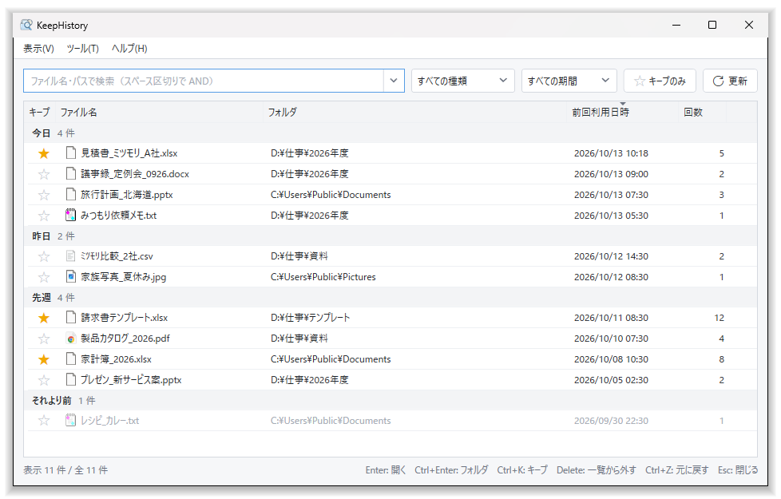
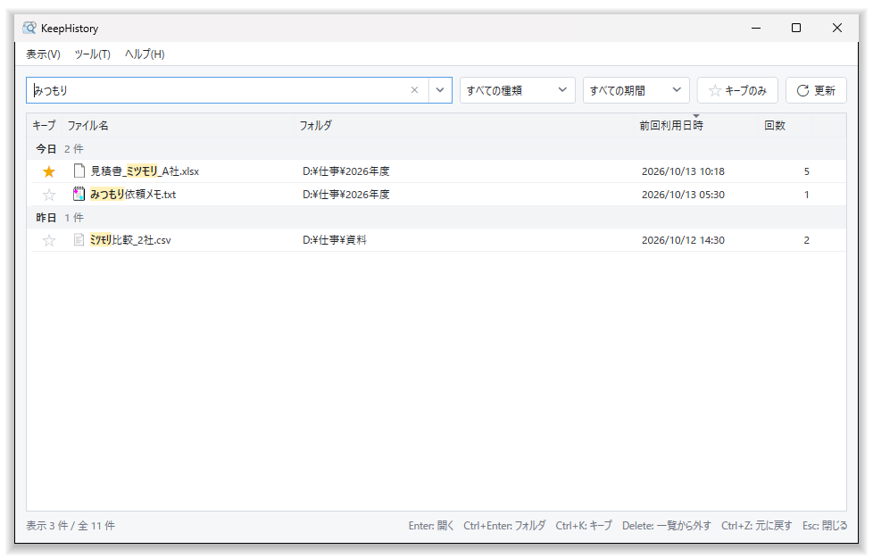
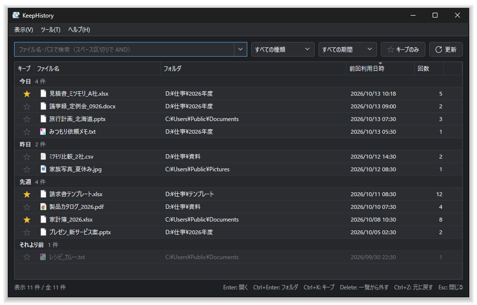

# KeepHistory

最近使ったファイルを一覧・検索できる Windows アプリです。

Windows の「最近使った項目」から履歴を自動で記録し、ファイル名やパスで検索できます。
設定で通知領域に常駐させると、ホットキー（既定 **Ctrl + Alt + H**）でいつでも呼び出せます。ホットキーは設定画面で変更できます。



## 画面

**検索**: ひらがな・カタカナ・半角カナ、全角・半角、大文字・小文字を区別せずに探せます。一致した部分は色付きで表示します。



**ダークモード**: Windows の設定に合わせるか、ライト・ダークを選べます。



画面の履歴は、説明用の架空のものです。

## 動作環境

- Windows 10 / 11（64 ビット）

## ダウンロード

1. [.NET 10 デスクトップ ランタイム（x64）](https://dotnet.microsoft.com/download/dotnet/10.0) をインストールしてください（まだ入っていない場合）。
2. [Releases](../../releases) から `KeepHistory-v（バージョン）-win-x64.zip` をダウンロードして展開し、`KeepHistory` フォルダの中の `KeepHistory.exe` を実行してください。

.NET デスクトップ ランタイムが入っていない場合は、起動したときに Windows がインストールを案内します。

## ご利用の前に

配布しているアプリ（exe）はデジタル署名をしていません。そのため、ダウンロードや初回の起動時に、Windows（SmartScreen）やウイルス対策ソフトの警告が表示される場合があります。

SmartScreen の警告が出た場合は、「詳細情報」→「実行」で起動できます。

### スマート アプリ コントロールについて

Windows 11 の「スマート アプリ コントロール」がオンになっている PC では、署名をしていないため、アプリの実行がブロックされる場合があります（ブロックされたときは、画面が表示されずに終了することがあります）。公開前に、スマート アプリ コントロールがオンの Windows 11 で起動できることを確認していますが、ブロックされるかどうかは Microsoft の判定によるため、必ず起動できるとは限りません。

ブロックされた場合、このアプリだけを許可する方法はありません。**解決策は、スマート アプリ コントロールをオフにすることのみです**（「Windows セキュリティ」→「アプリとブラウザーの制御」→「スマート アプリ コントロールの設定」）。

なお、最新の Windows Update を適用していれば、オフにした後も「Windows セキュリティ」から再びオンにできます。オフにするかどうかは、ご自身の判断でお願いします。

## 使用技術

- [.NET 10](https://dotnet.microsoft.com/)（C#）
- [WPF](https://github.com/dotnet/wpf)（画面）
- [Windows Forms](https://github.com/dotnet/winforms)（通知領域のアイコン）
- [System.Text.Json](https://learn.microsoft.com/dotnet/standard/serialization/system-text-json/overview)（履歴・設定の保存）

## ビルドと起動

ビルドには [.NET 10 SDK](https://dotnet.microsoft.com/download/dotnet/10.0) が必要です。

```
dotnet build
dotnet run --project src/KeepHistory/KeepHistory.csproj
```

テストは `dotnet test` で実行できます。

データは `%APPDATA%\KeepHistory\` に保存されます。
